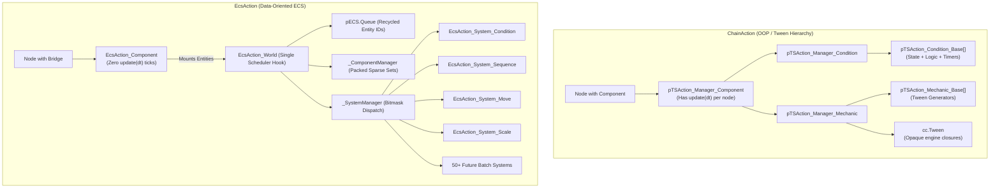
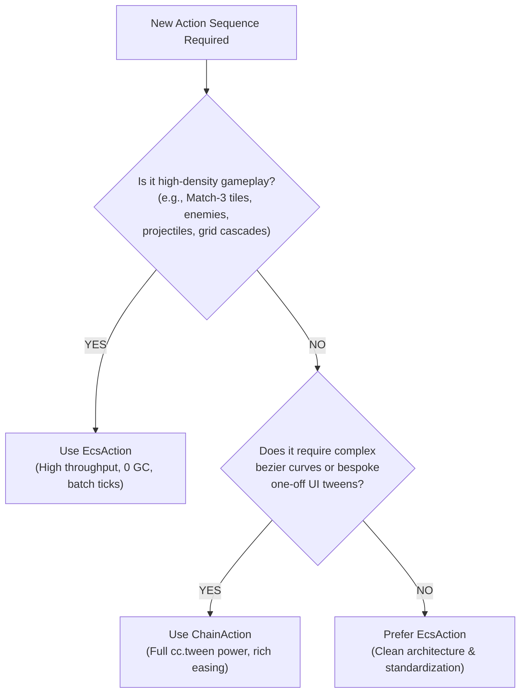

# Architectural Deep Dive: `EcsAction` vs. `ChainAction`

## 1. Executive Summary

Both **`ChainAction`** and **`EcsAction`** solve the problem of declarative, chained animation and conditional execution in Cocos Creator 3.8.8, but they approach the problem from fundamentally different software engineering paradigms:

- **`ChainAction`**: An **Asset-Driven Hierarchical Object-Oriented (OOP)** framework tightly coupled to Cocos Creator's `cc.tween` engine and node component lifecycle.
- **`EcsAction`**: A **Data-Oriented Entity Component System (ECS)** framework built on `pECS` from `pts-core`, featuring sparse sets, stateless batch systems, and a single centralized scheduler tick.

---

## 2. High-Level Architectural Comparison

---

## 3. Detailed Side-by-Side Comparison

| Dimension | `ChainAction` (Legacy OOP) | `EcsAction` (Data-Oriented ECS) |
| :--- | :--- | :--- |
| **Architectural Paradigm** | Hierarchical OOP + Event-driven Tweening. | Entity Component System (Sparse Set + Bitmask Archetype). |
| **Entity Representation** | Heavyweight Cocos `Node` + `Component` instances. | Opaque integer ID (`Entity = number`) allocated from a 5,000 recycled pool. |
| **Component Model** | Rich classes containing state (`_tick`, `_ready`), timers, promises, tween generators, and lifecycle methods. | Pure Data Structs (POD). State is stored in contiguous packed arrays; zero behavior inside data components. |
| **System Model** | Logic is scattered across `update()` hooks, asset methods (`Delay.tick`, `Sequence.generate`), and tween callbacks. | Pure, stateless Systems (`_System`) batch-iterating over entity sets with identical component signatures. |
| **Engine Scheduler Burden** | **$N$ per-node ticks**: Every active component registers an `update(dt)` in Cocos Creator director. | **1 single tick**: Only `EcsAction_World` registers an engine update for all entities in the game. |
| **Motion Engine** | Delegates to `cc.tween()`. Creates opaque closures, internal tween runners, and easing proxies. | Direct vector math on target nodes (`setPosition`, `setScale`) using reused scratch buffers (`_tempVec3`). |
| **GC / Allocation Pressure** | **High**: Clones assets, creates Maps (`_map`), string UUIDs, closure binders (`_ticks`), and event handlers per instance. | **Minimal**: Reusable integer IDs, dense array indices, static scratch vectors, zero closures in execution loops. |
| **Open-Closed Extensibility** | Mechanics can be extended via `pTSAction_Mechanic_Base`, but core execution is rigidly bound to `cc.tween`. | **Fully Open-Closed**: Any new `EcsAction.Data.*` and its system self-register dynamically on first mount without editing core files. |
| **State Introspection & Debugging** | Difficult: In-flight tween state is encapsulated inside opaque closures in Cocos engine. | Transparent: Inspect any entity at any frame via `compMgr.get(entity, CompType)`. Easy to pause, step, or serialize. |
| **Inspector UX** | Sub-managers for Conditions and Mechanics in nested property folds. | Clean, flat property lists on `EcsAction_Component` (`conditions: []`, `mechanics: []`). |

---

## 4. In-Depth Advantages & Disadvantages

### A. `ChainAction`

#### ✅ Advantages
1. **Rich Out-of-the-Box Engine Tween Integration**:
   - Directly leverages Cocos Creator's full `cc.tween` feature set (bezier curves, custom easing functions, complex path chaining).
2. **Specialized Condition Evaluators**:
   - Already has built-in support for compound Boolean logic (`pTSAction_Condition_Condition_And`, `Or`), instant loopers, and event listeners.
3. **Familiarity**:
   - Matches standard component-centric Cocos Creator patterns familiar to frontend game developers.

#### ❌ Disadvantages
1. **Severe Scaling Bottleneck (Tick & GC Overhead)**:
   - Having 100+ active `pTSAction_Manager_Component` instances incurs 100 individual `update(dt)` engine calls per frame.
   - Frequent creation and destruction creates heavy Garbage Collection (GC) spikes from tween closures, Map instances, and event bindings.
2. **Black-Box Execution**:
   - Once a `cc.tween` starts, it is nearly impossible to query intermediate values, rewind, or serialize playback state.
3. **Tight Coupling**:
   - Modifying how an action calculates progress requires refactoring the asset class, the sub-manager, and the tween generator simultaneously.

---

### B. `EcsAction`

#### ✅ Advantages
1. **Extreme Scalability & Frame Rate Stability**:
   - **Zero per-node update ticks**: Only 1 central tick updates thousands of active action entities.
   - Contiguous packed array access minimizes CPU cache misses.
   - Static scratch vector reuse eliminates runtime GC allocation.
2. **True Open-Closed Extensibility**:
   - Adding 50+ new actions (`Rotate`, `Color`, `Audio`, `Shake`, `PhysicsImpulse`, etc.) requires **zero changes** to `EcsAction_Component` or `EcsAction_World`.
   - Actions self-register their component stores and systems dynamically on first mount.
3. **Full State Introspection & Determinism**:
   - Entity state is completely transparent and queryable at runtime (`compMgr.get(entity, DataClass)`).
   - Enables time-scrubbing, replay logging, frame-stepping, and automated testing via snapshots.
4. **Codebase Standardization**:
   - Fully unified with the existing `pECS` framework in `pts-core`, preventing framework fragmentation.

#### ❌ Disadvantages
1. **32-Component Type Limit per World**:
   - Because `pECS.Queue` utilizes a 32-bit bitmask signature (`Uint32Array`), a single `pECS.Queue` can register a maximum of 32 distinct component types before requiring a secondary world or bitset expansion.
2. **Initial System Authoring Overhead**:
   - Each new mechanic requires both a Data descriptor (`EcsAction.Data.*.ts`) and a stateless System (`EcsAction.System.*.ts`), rather than a single inline tween callback.
3. **Learning Curve**:
   - Developers accustomed to traditional OOP/Cocos scripting must adapt to pure data separation and stateless system pipelines.

---

## 5. Architectural Decision Matrix: When to Use Which?

### Recommendation Guidelines

| Use Case Scenario | Recommended System | Justification |
| :--- | :---: | :--- |
| **Match-3 Board Clearing & Cascading Tiles** (100+ simultaneous falling/swapping gems) | **`EcsAction`** | Critical: Zero per-node ticks and zero GC allocations keep frame times rock-solid at 60 FPS. |
| **Enemy Spawn Waves & Bullet Trajectories** | **`EcsAction`** | Batched spatial calculations and entity recycling maximize performance on low-end mobile devices. |
| **Standalone UI Dialog Popups & Menu Transitions** | **`ChainAction`** | One-off animations with low entity counts benefit from fast bespoke `cc.tween` authoring. |
| **Complex Bezier Curve Camera Fly-Throughs** | **`ChainAction`** | Native Cocos spline and bezier tween math is already built into `cc.tween`. |
| **Standardized Reusable Element Actions** (Button pop, card flip, icon shake) | **`EcsAction`** | Decoupled ScriptableObject presets (`.pts` assets) drag cleanly into any entity. |
